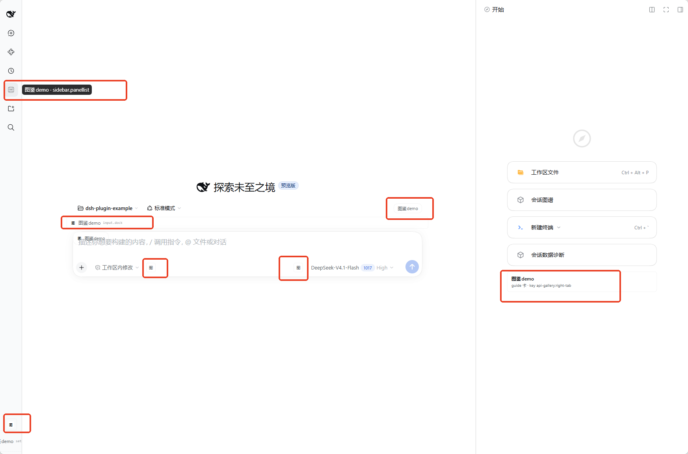

# DSH Plugin API Gallery · 插件接口图鉴

**你想给 DSH 加个功能，但说不清它该长在页面哪个位置？** 这个插件把 43 个可插入位置全部实装了一遍：每个入口都长在真实位置上、都带注册代码，点开就是“这里该怎么注册”。另有全量接口图鉴：100 个 Slot（其中 57 个不可注册，逐个写明为什么）、98 个 Host Service、76 个 Host Event、6 个 Factory。

Know what your plugin should do, but not where in the UI it belongs? 43 Slots demoed in their real positions, each with registration code — plus 100 Slots / 98 Host Services / 76 Host Events, including the 57 Slots you can't register, and why.

**装它解决三个问题：**我的功能该长在哪 → 看下表的意图索引；这个位置能不能插 → 看 43 个实测；某个接口存不存在、怎么调 → 查 Service / Event 页。

> 会在 43 处真实位置插入入口，建议装在测试 profile。找具体 Slot 直接 Ctrl+F 下面的 slot key 索引。



*红框里就是长在真实位置上的入口（不是总览页）：左侧栏 `sidebar.panellist` 的 tooltip、输入框上方 `conversation.input.dock`、composer 头部按钮、输入行左右两个「图」按钮、左下角 `sidebar.footer.action`，以及原生右侧栏里的图鉴 tab（`key: api-gallery:right-tab`）。*

---

## 先定位：我的功能该长在哪

先说人话再翻源码。左边是“我想做的功能”，右边就是该注册的接口 —— 以及本插件里它的真实样子（图里带红框的就是这些入口）。

| 你想做的事 | 该注册的接口 | 本插件里的实况 |
| --- | --- | --- |
| 在输入框旁加个按钮 | `conversation.input.left` / `conversation.input.right` | 输入行左右各一个「图」小按钮 |
| 在输入框上加常驻提示 | `conversation.input.dock`（卡片上方通栏）/ `conversation.composer.dock`（卡片下方 chip） | 两种都在图里，一眼看出区别 |
| 给会话加一整页新 tab | `conversation.view` | 顶部 View 标签栏多一个 `图鉴demo · conversation.view` |
| 在消息旁加操作 | `conversation.chat.assistant-actions` / `conversation.chat.turnTail` | 每条完成的 assistant 消息旁 / 每轮结束后一行 |
| 加设置页或设置行 | `settings.section`（整页）/ `settings.general.item`（偏好行）/ `settings.plugins.tab`（tab） | Settings 左侧导航多一页、General 多一行 |
| 加右侧栏 tab（文件、终端那一列） | `ctx.sidebarRightTabs.register`（tab 类型）+ `sidebar.right.pane.tab`（body） | **不是单靠 Slot**：先注册类型，再按 key 渲染 body |
| 在侧栏 Session 行加东西 | `sidebar.session.row.leading` / `sidebar.workspaces.session.row.action` / `sidebar.workspaces.session.menu.item` | 14px 徽标 / hover 按钮 / 「…」菜单项 |
| 加全局弹层或 Toast | `shell.overlay` | 所有小入口点开的详情弹层都在这里 |
| 加「+」菜单或斜杠命令 | `ctx.commandUi.register`（**是 Service，不是 Slot**） | composer 的「指令」分组里多一项 |
| 在插件详情页加区块 | `plugins.detail.section` / `plugins.detail.badge` / `plugins.detail.actions` | 详情页下方说明区、标题旁标签、操作按钮 |

**表里查不到，大概率就是“不该插”的位置。** 57 个 Slot 属于 single / chain / fixed-key / owner-dispatch-only，硬注册会替换内置 UI 或永远不渲染 —— 每一个都在「Slot / Factory」页写明了原因；全量 100 个 Slot 的 census 和 UI 区域图见 [docs/all-slots.md](docs/all-slots.md)，分类依据见 [docs/slot-classification.md](docs/slot-classification.md)。

---

## 43 个 Slot 都长在哪

这不是一个“接口总览页”。它把 **43 个 Slot 注册的 demo 直接放进各自的真实位置**：15 个既有代表性 Slot + **A-新增 18 项 + C 子集 10 项**（会话 View 标签栏、会话右上角、原生右侧栏、输入框、消息动作、Session 行、Settings、Plugins 页/详情页、main 面板、tool/command 视图，以及 onboarding/review/plan-review 等少见状态）……另外在 composer 的 **+ 菜单「指令」分组**里加了一项 `图鉴demo · commandUi.register`（客户端服务，不是 Slot）。每个 Slot 入口的标题都写成：

```text
图鉴demo · <slot-key>
```

例如 `图鉴demo · conversation.view`、`图鉴demo · conversation.session.header.utilities`。点击小入口会由 `shell.overlay` 弹出该 Slot 的完整说明、注册代码和实时效果；整页/整 tab 的 Slot 则直接把说明和代码渲染在自己的页面里。

> 接口快照来自 **DSH 0.2.1-rc.2**，扫描时间 **2026-10-23**。全量 98 个 Host Service、76 个 Host Event、100 个 Slot 的目录见 [docs/interface-catalog.md](docs/interface-catalog.md)。
>
> 安全边界：只注册 **list / 自家 key 的 keyed** Slot；不注册 single、chain、fixed-key、owner-dispatch-only key，也不替换任何内置 UI。B 类 57 个 + 6 个 Factory 保持不注册；A 33 + C 10 = 43 个可增量 Slot 已全部实现。分类依据见 [docs/slot-classification.md](docs/slot-classification.md)。

---

## 15 个保留 Slot 在哪里

| # | Slot | 你应该看到什么 |
| --- | --- | --- |
| 1 | `conversation.view` | 会话顶部 View 标签栏多一个 **图鉴demo · conversation.view** tab，内容显示 session、View id 和注册代码 |
| 2 | `conversation.session.header.utilities` | 会话右上角多一个 **图鉴demo** 按钮，tooltip 是完整 slot 名；点击弹详情 |
| 3 | `sidebarRightTabs.register` + `sidebar.right.pane.tab` | **原生 DSH 右侧栏**（文件、终端那一列）多一个 tab；从 + 菜单或本插件的按钮打开，标题 **图鉴demo · sidebarRightTabs.register** |
| 4 | `conversation.composer.dock` | 输入框下方多一个常驻 chip **图鉴demo · composer.dock** |
| 5 | `conversation.input.left` | composer 工具行左侧多一个 **图** 小按钮 |
| 6 | `conversation.input.right` | 提交按钮前多一个 **图** 小按钮 |
| 7 | `conversation.chat.assistant-actions` | 每条已完成的 assistant 消息旁多一个 **图鉴demo** 动作 |
| 8 | `conversation.chat.turnTail` | 每轮完成后的 action row 之前多一行 **图鉴demo · turnTail** |
| 9 | `sidebar.session.row.leading` | 侧栏每个 idle Session 行的最前面多一个 14px **图** 徽标 |
| 10 | `sidebar.footer.action` | 侧栏底部 Settings 旁边多一个 **图鉴demo** 动作；窄栏只显示图标 |
| 11 | `settings.section` | Settings 左侧导航多一页 **图鉴demo · settings.section** |
| 12 | `settings.general.item` | Settings → General 的偏好行里多一行 **图鉴demo** |
| 13 | `settings.plugins.tab` | Settings → Plugins 的 tab 列表多一个 **图鉴demo · settings.plugins.tab** |
| 14 | `shell.overlay` | 所有小入口点击后的详情弹层 + 右下角 Toast；弹层页脚标注“渲染于 shell.overlay” |
| 15 | `conversation.hero.options` | New Session 空状态的 Hero 行右侧多一个 **图鉴demo** 选项 |

> 11–13 和 15 只有对应的设置页/空状态真正挂载时才会注册；打开 Settings 或新建会话后就能看到。3 需要先有一个 Session（原生右侧栏本身就是 per-session 的）。

---

## A-新增 18 + C 子集 10（28 个新注册）

18 个 A 项全部实现；C 的 10 项也全部补齐（5 个少见状态的 list + 1 个 guide 卡 + main/panellist 对 + 两个 keyed chat 视图）。其中 20 个 list 项共用 `GENERIC_SLOTS` + `GalleryEntry` 通用组件（mode：button / icon-button / menu-item / row / badge / link / chip / inline），其余是 bespoke。**每个入口点击都打开同一个 `shell.overlay` 详情弹层**，展示该 Slot 的 desc 和注册代码；没有 per-entry 的私有弹层。

### A-新增 18

| # | Slot | 本插件 id | mode | 你应该看到什么 |
| --- | --- | --- | --- | --- |
| A1 | `settings.models.footer` | `api-gallery-models-footer` | row | Settings → Models 里 provider 行/add 控件之后多一行「图鉴demo」 |
| A2 | `settings.action` | `api-gallery-settings-action` | button | 设置内容列 header（Close 旁）多一个紧凑「图鉴」按钮 |
| A3 | `sidebar.workspaces.session.menu.item` | `api-gallery-session-menu` | menu-item | 侧栏 Session 的 **“...”** 菜单里多一行「图鉴demo」 |
| A4 | `sidebar.workspaces.session.row.action` | `api-gallery-session-row-action` | icon-button | hover Session 行时、**“...”** 之后多一个 24px「图」按钮 |
| A5 | `sidebar.session.row.hover` | `api-gallery-session-hover` | row | Session hover 卡里多一行「图鉴demo · session.row.hover」 |
| A6 | `plugins.tab` | `api-gallery-plugins-page-tab` | tab | Settings → Plugins 页多一个「图鉴demo · plugins.tab」tab（页内是 SlotPage） |
| A7 | `plugins.item` | `api-gallery-plugin-item` | row | Plugins Official 列表里多一张「图鉴demo」plugin 行 |
| A8 | `plugins.detail.actions` | `api-gallery-detail-actions` | button | Plugins 详情页 header（switch/uninstall 之前）多一个「图鉴」按钮 |
| A9 | `plugins.detail.badge` | `api-gallery-detail-badge` | badge | Plugins 详情页标题旁多一个「图鉴demo」标签 |
| A10 | `plugins.detail.section` | `api-gallery-detail-section` | inline-panel | Plugins 详情页下方多一块说明区 + 可复制注册代码 |
| A11 | `conversation.session.header.actions` | `api-gallery-header-actions` | button | 会话标题旁多一个「图鉴」按钮（比 utilities 更靠标题） |
| A12 | `sidebar.right.tab.files.actions` | `api-gallery-files-actions` | icon-button | 右栏 Files tab 工具栏（reload 之后）多一个「图」按钮 |
| A13 | `sidebar.right.tab.document.actions` | `api-gallery-document-actions` | button | 右栏文档预览工具栏多一个「图鉴」按钮（不调用 openFile） |
| A14 | `sidebar.right.tab.menu.item` | `api-gallery-right-menu` | menu-item | 右栏 tab 的 **“...”** 菜单里多一行「图鉴demo」 |
| A15 | `sidebar.right.pane.tab.title`（keyed） | key `api-gallery:right-tab` | chip | 图鉴右栏 tab 的 chip 标题变成自定义样式；与 body 同 key |
| A16 | `deliverables.file.actions` | `api-gallery-file-actions` | link | 完成 Turn 的尾行多一个「图鉴demo」链接（只开详情，不打开文件） |
| A17 | `conversation.input.overlay` | `api-gallery-input-overlay` | chip | composer 卡内多一个浮动「图鉴」chip |
| A18 | `conversation.input.dock` | `api-gallery-input-dock` | row | composer 卡上方多一行通栏「图鉴demo」条目 |

### C 子集 6（少见状态，已确认 occupant active）

| # | Slot | 本插件 id / key | mode | 你应该看到什么 |
| --- | --- | --- | --- | --- |
| C3 | `settings.onboarding` | `api-gallery-onboarding` | inline | 只有 onboarding 流程挂载时出现；当前 profile 已完成引导，通常看不到 |
| C4 | `plugins.add.actions` | `api-gallery-plugins-add-actions` | row | 只有 bundle 安装完成后的状态出现 |
| C5 | `sidebar.right.tab.document.unpreviewable` | `api-gallery-document-unpreviewable` | row | 只有打开一个不可预览文件时出现 |
| C6 | `deliverables.review.file.actions` | `api-gallery-review-file-actions` | link | 只有 changed-file review tab 存在时出现 |
| C7 | `conversation.plan-review.actions` | `api-gallery-plan-review-actions` | button | 只有 plan 正在 review 的瞬时状态出现 |
| C8 | `sidebar.right.tab.guide.entry`（keyed） | key `api-gallery:right-tab` | guide-card | 图鉴右栏 tab 的 guide 卡；已确认 key 被 owner 派发（occupant active） |

> 任务文本里的 `conversation.composer.plan-review.actions` 与 census / classification 的实时 key `conversation.plan-review.actions` 不一致，代码按 census 的真实 key 注册（见 `docs/all-slots.md` §2.8）。C 的 keyed guide 卡使用自家 tab key，只替换本插件自己的 fallback 标准卡。

### C 子集最后 4（本轮补齐）

| # | Slot | 本插件 id / key | mode | 你应该看到什么 |
| --- | --- | --- | --- | --- |
| C1 | `main`（keyed） | key `api-gallery-panel` | page | 侧栏图鉴demo 图标打开的中央面板；页面只演示 main slot，不是接口总览 |
| C2 | `sidebar.panellist` | `api-gallery-panel` | icon | 侧栏全局面板图标；entry id 与 main key 都是 `api-gallery-panel`，点击图标打开 C1 |
| C9 | `tool.call.toolview`（keyed） | key `api_gallery_demo` | tool-card | Host 注册 `api_gallery_demo` 工具后，调用它的卡片渲染自定义视图 |
| C10 | `conversation.chat.commandview`（keyed） | key `api-gallery` | command-row | Host 注册 `/api-gallery` 命令后，命令行渲染自定义视图 |

> Host 半现在注册了 `api_gallery_demo` 工具和 `/api-gallery` 命令，专门让 C9/C10 的 key 可达；tool/command view 的 key 与 host 名称完全一致。main + panellist 是成对实现，已确认两个 occupant 都 active。

---

## 仍未实现（B 类 + Factory，不可增量 / 不可见）

| Slot / 类别 | 数量 | 跳过原因 |
| --- | ---: | --- |
| B 类：single | 43 | owner 只渲染一个节点，注册即替换内置 UI（`root`、`sidebar`、`settings.trigger`、`conversation.composer.bar` 等）。 |
| B 类：chain | 3 | `shell.quota-notice`、`sidebar.right.tab.guide`、`conversation.composer` 是 selector 路由替换，不是追加入口。 |
| B 类：fixed-key keyed | 4 | `workspace.toast` / `conversation.user.text.node` / `conversation.chat.node` / `tool.view.cordis` 的 key 集合由 owner 固定，无法新增。 |
| B 类：owner-dispatch-only keyed | 7 | key 由 owner 注册表派发（provider-card / bundle config / document renderer 等），注册了也永远不渲染。 |
| Factory | 6 | 由 owner 直接渲染的子界面，不是注册点。 |

> 43 个可增量 Slot（15 原有 + 18 A + 10 C）已全部注册；`main` + `sidebar.panellist`、`tool.call.toolview`、`conversation.chat.commandview` 也已补齐。剩余 B 类 57 + Factory 6 属于“不可增量/不可见”，注册只会替换内置 UI 或永远不渲染，因此不注册。

## 非 UI 接口参考页

侧栏的 **图鉴demo** 图标（`sidebar.panellist`）打开的 `main` 页面是“非 UI 接口参考页”，有四个 tab：

- **Slot / Factory（63）**：57 个不可见 Slot + 6 个 Factory；数据 `non-ui-slots.json`，路由 `GET /plugin-api-gallery/non-ui`；分组 `single 43 / chain 3 / fixed-key 4 / owner-dispatch 7 / Factory 6`；顶部 UI 位置示意图（左栏 / 中央 / 右侧 + frame / overlay）可点击过滤；每行有区域标签、breadcrumb、purpose、parent、replaceRisk、keyDomain、registration 和逐项原因。
- **Events（80）**：76 Host Events + 4 Client Events；数据 `interfaces-reference.json`，路由 `GET /plugin-api-gallery/interfaces`；每行显示 mode、signature、描述和 `ctx.on(...)` 观察/waterfall 片段。
- **Services（110）**：98 Host Services + 8 Client Services + 4 个 source-verified 但 Inspect 目录未列出的 Client Services（`sidebarRight` / `sidebarRightTabs` / `commandUi` / `inputTriggers`）；每行显示 methods、`ctx.get(...)` 片段，并标注“图鉴已用”。
- **Tools / Builtins**：当前模型可见 Tools（来自 `/state`，当前 43 个）+ 5 个 Client Builtins；Theme tokens 收在折叠区，标注它们是 UI 令牌而不是事件/接口。

页面顶部搜索可过滤当前 tab；所有数据来自只读 JSON 路由，不注册任何额外 UI。所有条目的**主描述使用中文**（Slot 原因、事件分类/用途、服务分类/用途、工具/内建符号说明）；原始英文 purpose/description 收在每行的「原文（English）」折叠里，方便核对来源。`main` + `sidebar.panellist` 自身的注册代码和 Host 快照在页面底部折叠区。

> UI 位置示意图是**概念布局**，不是像素级截图；它用来回答“这个 Slot 管的是哪一栏/哪一块”，精确位置仍需对照实际界面。当前环境没有浏览器控制入口，无法生成带标注的真实截图。

它不是 43 个可交互 Slot 的总览页；43 个入口仍然分布在各自的真实位置。

## 额外：composer 「+」菜单里的一项（不是 Slot）

composer 左边的 **+** 按钮点开后会显示「添加 / 指令」两组。这里**没有对应的 Slot**；扩展点是客户端服务 `ctx.commandUi.register`：

```js
ctx.inject(['commandUi'], (scope) => {
  scope.effect(() => scope.get('commandUi').register({
    name: 'api-gallery-demo',
    label: () => '图鉴demo · commandUi.register',
    description: () => '客户端命令菜单扩展（不是 Slot）',
    icon: GalleryMenuIcon,
    available: () => true,
    ui: {
      kind: 'action',
      run: () => openSlotDetail('commandUi.register'),
    },
  }));
});
```

- 自定义 contribution 会出现在 **「指令」分组**末尾；`/` 菜单里也能看到，输入 `/api-gallery-demo` 也能触发。
- **「添加」分组**的内置行（File / Goal / Plan / Feedback）是 `ui-commands` 源码里的固定名单，没有公开接口把自定义项插进去；要改只能改内置包。
- 点这一行会打开共享详情弹层，里面写明这是 client service 而不是 Slot。

---

## 原生右侧栏：不是 better-sidebar

这是本轮最关键的接口区别：

| 层 | 接口 | 作用 |
| --- | --- | --- |
| tab 列表/类型 | `ctx.sidebarRightTabs.register({ id, kind, priority, title, guide })` | 往原生右侧栏注册一个 tab 类型；`guide` 决定它是否出现在 + 菜单/guide 里 |
| tab 内容 | `ctx.slots.register({ name: 'sidebar.right.pane.tab', key: definition.id }, Body)` | 按类型 id 渲染 tab 的 body；body 通过注入的 `useTabInfo()` 拿 `{ sidebar, panel, tab }` |
| 打开/导航 | `ctx.sidebarRight.openTab(kind)` | 展开右栏并打开该 kind；没有 Session 时会抛错 |

本插件用的是 **DSH 自带 `@deepseek-ai/dsh-client-ui-sidebar-right`** 的服务，不依赖 better-sidebar。`sidebar.right.pane.tab` 不是“往列表里加一项”的 Slot——它只渲染 body；加列表项必须走 `sidebarRightTabs.register`。代码见 `client.js` 的 `RIGHT_TAB_ID` / `RIGHT_TAB_KIND` 部分。

---

## 设计约定

- **只占用可增量注册的 Slot**：list 用新 `id`（`api-gallery-<slug>`），keyed 只用自家 key（`api-gallery:right-tab`、`api-gallery-panel`、`api_gallery_demo`、`api-gallery`）。`sidebar`、`rightbar.session` 这类 single/replace 型 Slot 不硬塞，避免替换内置 UI。当前共 43 个 Slot 注册 = 37 list + 6 keyed，其中 28 个是本轮新增。
- **数据驱动，不写 28 个 bespoke 组件**：`GENERIC_SLOTS` 数组描述 slot / id / mode / order / desc，`GalleryEntry` 一个组件覆盖 8 种 mode；只有 `plugins.tab`、`plugins.detail.section`、`sidebar.right.pane.tab.title`、`sidebar.right.tab.guide.entry`、`main`/`PanelIcon`、`tool.call.toolview`、`conversation.chat.commandview` 是 bespoke。
- **完整标题 + 紧凑控件**：tab/页面/列表项显示 `图鉴demo · <slot>`；header/input 这类空间小的控件显示短标签（「图」/「图鉴」/「图鉴demo」），完整 slot 名放 `title` / `aria-label` 和详情弹层标题。
- **每个 demo 都是真实实现**：View 真的能切、右侧栏 tab 真的能开、Settings 页真的在导航里、按钮真的可点；不是截图或静态说明。
- **共享详情面**：小入口统一调用 `openSlotDetail(slotKey)`，由 `shell.overlay` 里的 modal 显示 slot 元数据、完整注册代码、`replaceRisk`、owner props 和实时值。这样 `shell.overlay` 本身也是一个真实 demo，而不是一个隐藏的基础设施。
- **防御式渲染未知 owner props**：A5/A12/A13/A16 等 Slot 的 owner props 静态未知；`GalleryEntry` 只读注入的 `entry`，不读、不猜 owner props，也绝不调用 `openFile` 等副作用。
- **样式只用主题令牌**：`--dsw-alias-*`；明暗主题自动跟随；不 import 任何 Harness Client 包。

---

## 项目结构

```text
.
├─ client.js                    43 个 Slot 注册（15 保留 + 24 新增 + 4 最后补齐）+ 非 UI 接口参考页
├─ index.js                     Host 半：/state + /non-ui + /interfaces 只读数据 + api_gallery_demo 工具 + /api-gallery 命令
├─ catalog.json                 全量接口快照（文档用，不参与 UI）
├─ non-ui-slots.json           57 个不可见 Slot + 6 Factory 的逐项原因（页面数据）
├─ interfaces-reference.json   76 Host Events / 4 Client Events / 106 Services / Builtins（页面数据）
├─ cordis.patch.yml             Loader 行
├─ package.json                 bundle manifest（dsh.bundle + dsh.client）
├─ locale/{en,zh}.json          插件标题/描述
├─ icon.svg                     插件图标
├─ docs/interface-catalog.md    98 Services / 76 Events / 100 Slots 全量目录
├─ docs/slot-classification.md  task-2 分类：A 33 / B 57 / C 10（最终 C 10 全部实现）
├─ docs/all-slots.md            task-1 全量 Slot census
├─ docs/slot-demos.md           43 个 Slot 注册的契约与注册矩阵（验证用）
├─ scripts/build-catalog.cjs    从 .scan/ 生成 catalog.json
├─ scripts/build-docs.cjs       从 catalog.json 生成 interface-catalog.md
├─ scripts/build-non-ui.cjs     从 catalog.json 生成 non-ui-slots.json
├─ scripts/build-interfaces.cjs 从 catalog.json + source-verified services 生成 interfaces-reference.json
└─ .scan/                       cordis_inspect_query 原始快照
```

### Host 半

`index.js` 用 `ctx.webServer.register` 暴露只读的 `/plugin-api-gallery/state`（实时 session / tool / server）、`/non-ui`（57+6 参考数据）、`/interfaces`（Events / Services / Builtins 参考数据）；另外注册两个 demo 能力，让两个 keyed Slot 有真实 key 可派发：

- `ctx.tools.register` → `api_gallery_demo`（`tool.call.toolview` 的 key）
- `ctx.commands.register` → `/api-gallery`（`conversation.chat.commandview` 的 key）

它不注册 prompt section。

### Client 半

`client.js` 的 `META` 为每个 Slot 保存 `kind`、`scope`、说明和最小注册代码；`GENERIC_SLOTS` 是 20 个 list Slot（15 A + 5 C）的唯一数据源，`register()` / 通用注册循环统一调用 `ctx.slots.inject(slot, () => ctx.slots.register(...))`。`GalleryEntry` 覆盖 8 种 mode；`plugins.tab`、`plugins.detail.section`、`sidebar.right.pane.tab.title`、`sidebar.right.tab.guide.entry`、`main`/`PanelIcon`、`tool.call.toolview`、`conversation.chat.commandview` 是 bespoke 组件。原生右侧栏的 tab 类型用 `ctx.get('sidebarRightTabs')` 注册，body / title / guide 卡都用自家 key `api-gallery:right-tab` 注册。

通用注册模式：

```js
ctx.slots.inject(entry.slot, () => ctx.slots.register({
  name: entry.slot,
  id: entry.id,               // api-gallery-<slug>
  order: entry.order,
  label: () => `图鉴demo · ${entry.slot}`,
}, (props) => h(GalleryEntry, { ...props, entry })));
```

---

## 安装、更新、卸载

本项目已通过 Plugin Manager 安装到 profile `web`。源码安装：

```text
plugin_manager { action: "install_bundle", target: "C:/Users/54647/Developer/myProjects/dsh-plugin-example" }
```

- **Client 改动**（`client.js`）：`patchReload: live` 时 HMR 自动替换；没生效就硬刷新页面（`Ctrl+Shift+R`）。
- **Host 改动**（`index.js`）：需要重启 DSH，或禁用/重新启用 `api-gallery` 这一行让 Loader 重新导入。
- **卸载**：Plugin Manager 移除 `dsh-plugin-api-gallery`。

---

## 验证状态

### 注册 + live occupant 验证（已通过）

- `node --check client.js` / `node --check index.js` 通过。
- 43 个 Slot 注册 = **37 list + 6 keyed**（`sidebar.right.pane.tab` body、`sidebar.right.pane.tab.title`、`sidebar.right.tab.guide.entry`、`main`、`tool.call.toolview`、`conversation.chat.commandview`）。
- 24 个新增 A/C 项 + 最后 4 项已逐一用 `cordis_inspect_query` 抽查 occupant，全部 active：
  - P1/Plugins：`api-gallery-models-footer`、`api-gallery-settings-action`、`api-gallery-header-actions`、`api-gallery-plugins-page-tab`、`api-gallery-plugin-item`、`api-gallery-detail-actions`、`api-gallery-detail-badge`、`api-gallery-detail-section`；
  - Session/侧栏：`api-gallery-session-menu`、`api-gallery-session-row-action`、`api-gallery-session-hover`、`api-gallery-file-actions`；
  - Composer：`api-gallery-input-overlay`、`api-gallery-input-dock`；
  - 右栏：`api-gallery-files-actions`、`api-gallery-document-actions`、`api-gallery-right-menu`、`api-gallery:right-tab`（body/title/guide 三个 keyed occupant 都 active）；
  - C 子集：`api-gallery-onboarding`、`api-gallery-plugins-add-actions`、`api-gallery-document-unpreviewable`、`api-gallery-review-file-actions`、`api-gallery-plan-review-actions`；
  - 最后 4：`api-gallery-panel`（sidebar.panellist 与 main key 都是它）、`api_gallery_demo`（tool.call.toolview key）、`api-gallery`（conversation.chat.commandview key）。
- Host tool `api_gallery_demo` 已实际调用成功（返回 echo + Host 时间），tool view 有真实 key 可派发；Host `/api-gallery` 命令已注册，command view occupant 已 active。
- `GET /plugin-api-gallery/non-ui` 返回 200，`total=63`，counts = `single 43 / chain 3 / fixed 4 / owner 7 / factory 6`；`main` 与 `sidebar.panellist` 的 `api-gallery-panel` occupant 均 active，页面数据链路可用。
- `GET /plugin-api-gallery/interfaces` 返回 200：76 Host Events / 4 Client Events / 98 Host Services / 8 Client Services / 4 source-verified extras / 5 Client Builtins / 14 theme tokens；Tools tab 的实时 tools 来自 `/state`（当前 43 个）。
- 既有 15 个保留项仍 active；`main`/`sidebar.panellist` 在旧总览页阶段没有 occupant，现在分别由 `api-gallery-panel` 占用（成对实现，不是旧总览页）。
- 额外的 `ctx.commandUi.register` action 已按内置 File action 的同构写法注册；`+` 菜单的实际渲染和点击未能截图验证。

**视觉验证**：当前环境没有可用的浏览器控制入口，无法截图确认像素级效果。请硬刷新页面后逐个查看；若某个入口不出现，先确认对应上下文是否挂载（Settings / Plugins 详情 / 右栏 Files 或 Document / hover / menu / onboarding / review / plan-review）。

---

## 已知问题

- **sidebar.panellist 打开的是“非 UI 接口参考页”**：为了覆盖 main + sidebar.panellist 这两个 Slot，侧栏多了一个 3×3 点阵图标；点开后的页面有 Slot/Factory、Events、Services、Tools/Builtins 四个 tab。它不注册这些非 UI 接口，只做只读参考；如果不需要，删掉这两个注册即可（它们是独立的一对）。
- **tool/command 视图需要调用才可见**：`tool.call.toolview` 只有模型调用 `api_gallery_demo` 时出现；`conversation.chat.commandview` 只有输入 `/api-gallery` 时出现。两者都已在 Host 注册，但 UI 点击未截图验证。
- **C 子集出现条件苛刻**：`settings.onboarding`、`plugins.add.actions`、`sidebar.right.tab.document.unpreviewable`、`deliverables.review.file.actions`、`conversation.plan-review.actions` 只在 onboarding / 安装完成 / 不可预览 / review / plan-review 状态出现；occupant 已确认 active，但正常聊天流程中可能看不到。
- **better-sidebar 仍是 pending**：安装本插件时 Plugin Manager 报告 `better-sidebar: pending (waiting for service: webRuntime)`。这与本插件无依赖关系；重启 DSH 或升级/检查 better-sidebar 可恢复。原生 DSH 右侧栏的文件/终端 tab 不受影响。
- **原生右侧栏需要 Session**：`ctx.sidebarRight.openTab` 在没有 Session 时会抛错，本插件会捕获并弹 Toast。
- **详情弹层会拦截页面交互**：这是 modal 的预期行为；`Escape` 或点遮罩关闭。

---

## 加一个新的 Slot demo

优先走数据驱动（list 型、通用控件）：

1. 在 `GENERIC_SLOTS` 追加 `{ slot, slug, mode, order, scope, desc }`；id 会自动变成 `api-gallery-<slug>`，META 代码自动生成；
2. 确认 `mode` 在 `button / icon-button / menu-item / row / badge / link / chip / inline` 内，否则给 `GalleryEntry` 加一个分支和 `.sl-gen-<mode>` 样式；
3. 注册循环会自动 `ctx.slots.inject` + `register`，无需改 `apply`；
4. 只有整页 / 内联区块 / keyed 标题这类特殊形态才写 bespoke 组件，并补 `listMeta`/手写 META；
5. 更新 `docs/slot-demos.md` 和本 README 的表，并确认没有碰 single / chain / fixed-key / owner-dispatch Slot。

---

## License

示例代码可自由复制、修改、再发布。

